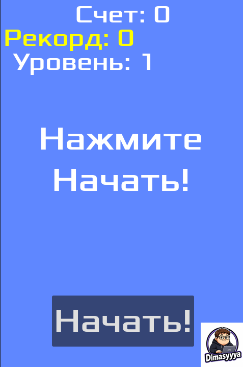
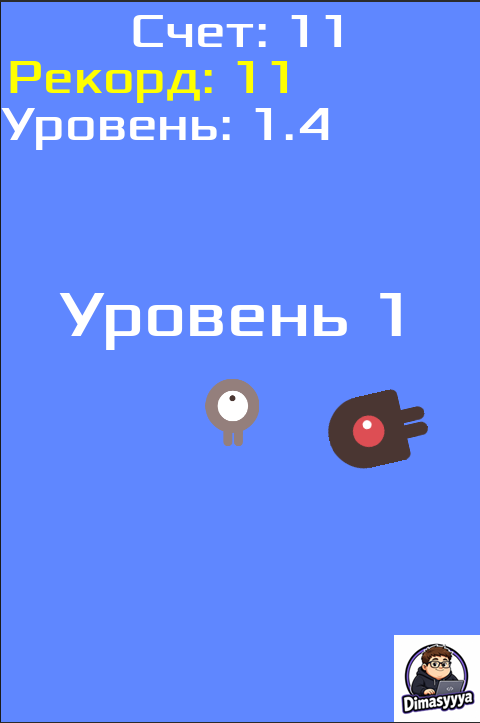

# 2D Monster Run

<p align="center">
  <strong>Небольшой 2D платформер о выживании, монстрах и бесконечном беге.</strong>
</p>

<p align="center">
  
  
  
</p>

---

## Об игре

**2D Monster Run** - это небольшая 2D-игра, разработанная на движке Godot и вдохновленная официальным руководством по *Вашей первой 2D-игре в Godot*.

Этот репозиторий представляет собой мой первый опыт в разработке игр на Godot.

## КиллерФишки
- **Столкновения с монстрами** — враги появляются и атакуют в процедурном режиме.
- **Игровой дисплей** — отображение результатов и индикатора сложности игры.
- **Пользовательские визуальные эффекты** — дополнительные ресурсы и шрифты.
- **Windows build** — автономный исполняемый файл для легкого доступа.

## Скриншоты

<p align="center">
  
  
</p>

## Запуск игры

### Готовая сборка Windows

1) Открой раздел Releases.

2) Скачай архив последней версии игры.

3) Распакуй архив.

4) Запусти 2DMonsterRun.exe.

Если опубликованной сборки ещё нет, воспользуйся запуском из исходного кода.

### Запуск из исходного кода

Необходимые инструменты:

- [Godot Engine 4.x](https://godotengine.org/download/)
- Git (Необязательно)

1. Склонируй репозиторий:
   ```bash
   git clone <https://github.com/Dimasyaaa/2D-Monster-Run-Godot-.git>
   ```

2. Открой проект в Godot, выбрав файл `project.godot`.

3. Нажми F5, чтобы запустить основную сцену проекта.


## Технологии

| Технология | Назначение |
|---|---|
| [Godot Engine 4.x](https://godotengine.org/) | Среда разработки |
| GDScript | Язык программирования |
| Git | Контроль версий |
| GitHub | Хранение исходного кода и релизов |

## Цели проекта

Этот проект был создан для того, чтобы:
- Изучить основы разработки 2D-игр на Godot.
- Разобраться в сценах, узлах, сигналах и физике в Godot.
- Попрактиковаться в структурировании игрового кода и управлении игровыми состояниями.

## Источники

Проект основан на официальном учебном пособии Godot:

- [Your first 2D game — Godot Documentation](https://docs.godotengine.org/en/stable/getting_started/first_2d_game/index.html)
